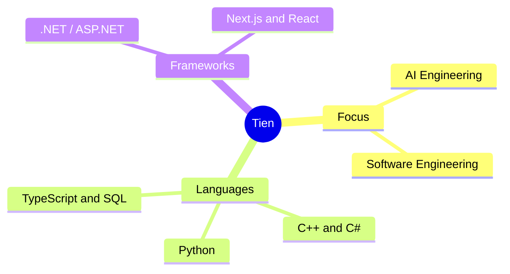

# Tien (aoe1920)

Undergraduate student majoring in **Information Systems** at the **University of Science, VNU-HCM**.

---

### About Me
- **University:** VNU-HCM University of Science
- **Faculty:** Faculty of Information Technology
- **Major:** Information Systems
- **Location:** Ho Chi Minh City, Vietnam
- **Areas of Interest:** AI Engineering, Software Engineering

---

### Technical Skills

| Category | Technologies and Tools |
| :--- | :--- |
| **Programming Languages** | C++, C#, Python, SQL, TypeScript, JavaScript |
| **Frameworks and Libraries** | .NET / ASP.NET, React, Next.js, Node.js |
| **Environment and Tools** | Git, Linux, Docker, VS Code, Visual Studio |
| **Typesetting and Formats** | Typst, LaTeX, Markdown |

---

### GitHub Overview

  
  

  

---

### Contact

